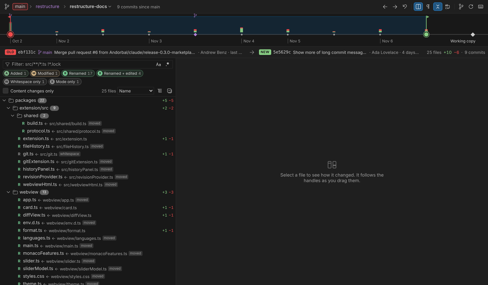
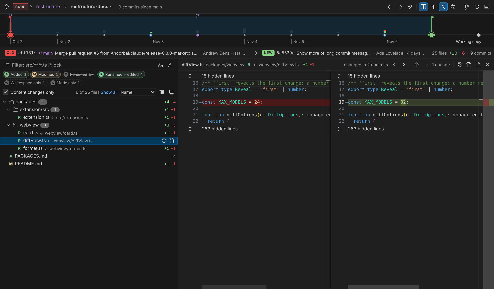
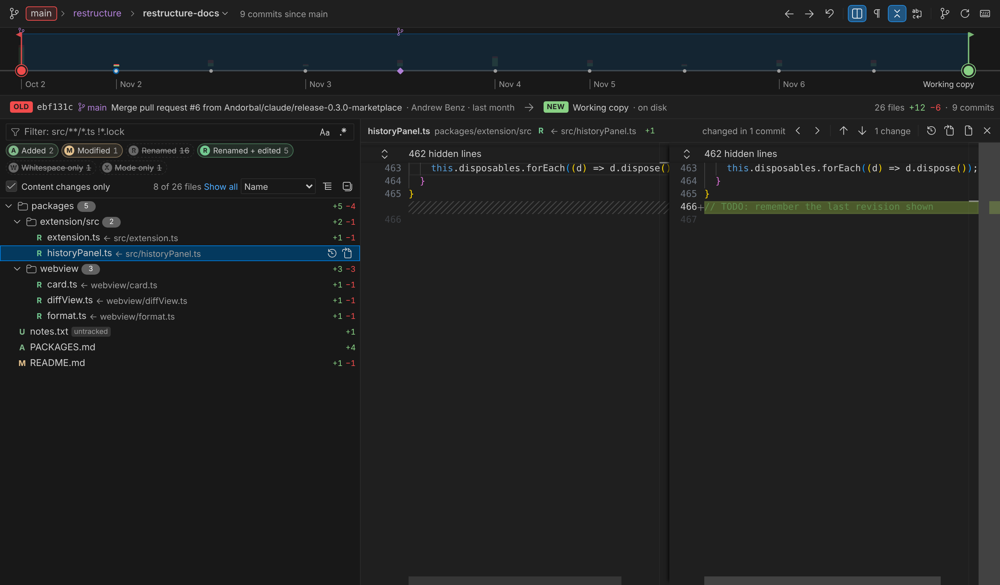

# History Slider

Scrub through a file's git history with a slider and watch the diff update as you drag.


<sub>The recordings of a file's history on this page were made in VS Code on the history of [Express](https://github.com/expressjs/express) (MIT License).</sub>

Most history tools give you a list of commits. To see how a file changed, you open a commit, find the file, pick "compare with previous" or "compare with working copy", and repeat for the next commit. History Slider puts the file's whole history on one timeline above a diff and gives you two handles to drag.

## Using it

Open a file and press **Ctrl+Alt+H** (**⌃⌘H** on macOS). You can also run it from:

- the **Show File History Slider** button (the compare icon) in the editor title bar
- the right-click menu of a file in the Explorer, an editor tab, or the Source Control view
- a commit in the **Timeline** view, which opens the slider on that commit's change
- the Command Palette: **History Slider: Show File History Slider**

### The timeline

- **Each dot is a commit that changed this file.** The oldest loaded commit is on the left. Your **working copy** is the diamond on the far right. If the file has staged changes, a **Staged** stop sits just before it.
- **The bar above each commit shows how much it changed** (green for added lines, red for removed), on a log scale so small fixes stay visible next to big rewrites. Commits whose changes are inside the current diff are highlighted.
- Tags show as small tag markers. Month and year labels run along the bottom.
- **Commits that don't change what the diff shows are left out**: ones that only rename the file, change its mode, or convert its line endings. The header says how many are hidden. Uncheck **Content changes only** in the toolbar to put them back on the timeline.


### The two handles

When the slider opens, one handle sits on the **latest commit** and the other on the **working copy**, so you see your uncommitted changes. From there:

- **Drag a handle.** The diff updates live, and a card follows the handle showing the commit's message, author, date, and line counts.
- **Drag the other handle too.** Each handle moves on its own, and they can cross. **Whichever handle is further left is always the _old_ side of the diff** (red), and the right one is the _new_ side (green).
- **Click anywhere on the timeline** to jump the nearest handle there, then keep dragging.
- **Need older history?** Drag a handle to the left end and more commits load as you go. You can also click **‹ Older** (Shift+click loads the entire history). Only the first 50 commits load up front, so the slider opens fast on long histories.

### Other things you can do


- **Double-click a commit** (or use **Show this change** on its card) to see just the change that commit made.
- **Walk the history one commit at a time**: `[` and `]` (or Shift+←/→) move both handles together, keeping the gap between them.
- **Live working copy.** Edits you make to the file, saved or not, show up in the diff as you type.
- **Follows renames.** History continues through `git mv`, and the old side shows the file under its old name.
- **Refreshes itself** when you commit, check out, or stage, even from a terminal.
- **Open in VS Code's own diff editor** (toolbar button or `O`) to get full language features on the same comparison.
- **Open a file at any revision** or **copy a commit SHA** from the commit card.
- Toggle **side-by-side / inline**, **ignore whitespace**, **collapse unchanged regions**, and **word wrap** from the toolbar. Moved code blocks are detected and marked.
- The panel survives a window reload and comes back with the same handles selected.


### Keyboard

| Keys | Action |
| --- | --- |
| ← / → | Move the focused handle one commit |
| Shift + ← / → or `[` / `]` | Move both handles together |
| Home / End | Move the focused handle to the oldest / newest stop |
| Tab | Switch between the two handles |
| `N` / Shift+`N` | Next / previous change in the diff |
| `S` · `W` · `C` · `Z` | Toggle side-by-side · ignore whitespace · collapse unchanged · word wrap |
| `R` | Reset to latest commit ↔ working copy |
| `O` | Open this comparison in the VS Code diff editor |
| `?` | Show the shortcuts |

Clicking the **OLD** or **NEW** label under the timeline focuses that handle.

## A whole branch

**History Slider: Show Branch History Slider** (the branch button in the Source Control view's title bar, or **Ctrl+Alt+Shift+H** / **⌃⇧⌘H**) puts a branch on the same kind of timeline. Instead of one file's diff, it shows every file the branch changed.

![The branch view on restructure-docs, which is stacked on restructure: clicking the main button at the left end of the timeline moves the base up to where restructure was branched from main, and the list fills with renamed files; checking Content changes only leaves the 6 files whose lines changed; clicking diffView.ts shows its diff beside the list and marks the two commits that changed it; dragging the new handle back updates the list and the diff together; R resets, typing in the filter narrows the list, and hovering a commit shows its card](media/demo/branch-history.gif)

<sub>The branch view's pictures show its panel on a copy of this repository, with a stacked pair of branches that move the code into packages.</sub>

- **The timeline runs from where the branch was branched to its newest commit.** The base sits at the left end; commits after it follow the branch's first-parent line, so merging main in is one step. On the checked-out branch, **Staged** and **Working copy** stops (untracked files included) come after the newest commit when there are any.
- **Go up the tree for stacked branches.** The title shows the bases it found, like `main › feature-a › feature-b`. Click the button at the left end of the timeline (it names the next branch up), press `U`, or click a branch in the title to start from where *that* branch was branched instead; `Shift+U` goes back down. The handles can't be put on just any two commits: they stay on the line between the base and the branch.
- **Pick another branch** with the branch name in the title (or `B`). Local and remote branches both work; everything resets to the new branch, from its nearest base.
- The handles, the commit card, double-click to see one commit's change and the keyboard work as they do for a file.



### The file list

Every file that changed between the two handles, as a tree or a flat list, with git's status letter, the old name of anything renamed, and line counts.

- **Filter by kind of change.** Each file is one of **Added**, **Modified**, **Deleted**, **Renamed** (moved, content unchanged), **Renamed + edited**, **Copied**, **Whitespace only** (whitespace or line endings) or **Mode only** (like `chmod +x`). Click a chip to hide or show that kind; Alt+click shows only that kind. **Content changes only** hides pure renames, whitespace-only and mode-only changes in one go, leaving just the files whose lines actually changed. The kinds you hide are remembered.
- **Filter by name** (`/`): terms separated by spaces must all match the path (or a renamed file's old path). Plain text matches anywhere, globs like `*.ts`, `src/**/*.test.ts` and `*.{ts,tsx}` work, `a,b` matches either, and `!term` leaves matches out: `src/ !*.lock !**/generated/**`. Turn on the `.*` button for a regular expression, `Aa` to match case.
- Sort by name, lines changed or kind, and collapse folders.



### The file beside it

Click a file (or move through them with the arrow keys, or `,` and `.`) to see its diff next to the list. It's **locked to the slider**: drag a handle and it updates along with the list, following the file through renames. The commits that changed it light up on the timeline, and `{` / `}` jump to the previous or next of them.

To look at a file on its own, use **Open in a new History Slider** (on the row, in the pane, `H`, Shift+Enter, or double-click). It opens the file's usual History Slider beside the branch view, starting on the same two points (the newest commits at or before each handle that changed the file), and the two panels don't affect each other after that. **Open in the VS Code diff editor** (`O`) is there too.



## Settings

| Setting | Default | |
| --- | --- | --- |
| `historySlider.pageSize` | `50` | Commits loaded at a time (twice that, at least 100, in the branch view) |
| `historySlider.followRenames` | `true` | Follow history across renames (`git log --follow`) |
| `historySlider.firstParentOnly` | `false` | Only show first-parent commits, so each merged branch is one step |
| `historySlider.showStaged` | `true` | Add a **Staged** stop when the file has staged changes |
| `historySlider.maxFileSizeMB` | `5` | Revisions larger than this aren't loaded |
| `historySlider.renderSideBySide` | `true` | Side-by-side or inline diff (also a toolbar toggle) |
| `historySlider.ignoreTrimWhitespace` | `false` | Ignore leading/trailing whitespace (also a toolbar toggle) |
| `historySlider.hideUnchangedRegions` | `false` | Collapse unchanged regions (also a toolbar toggle) |
| `historySlider.wordWrap` | `false` | Wrap long lines (also a toolbar toggle) |
| `historySlider.contentChangesOnly` | `true` | Hide commits that only rename the file, change its mode or convert its line endings (also the **Content changes only** checkbox) |
| `historySlider.showEditorTitleButton` | `true` | Show the button in the editor title bar |

## Requirements

- VS Code 1.90 or newer
- `git` (the extension uses the same git that VS Code's built-in Git extension uses)

## Limitations

- The diff inside the panel is read-only. Use **Open in VS Code diff editor** to edit or to get language features.
- Syntax highlighting comes from the Monaco editor's built-in grammars. It follows your theme's editor and diff colors, but token colors can differ slightly from your editor's.
- Binary files, and revisions over `historySlider.maxFileSizeMB`, show a message instead of a diff.
- Merge commits are compared against their first parent.
- The branch view finds a branch's base from the other branches (local and remote) that share its history. When two branches have both moved on since they split, git can't tell which one was branched from the other; History Slider uses the branch's reflog (where it pointed when it was created) to tell, so a branch stacked on yours isn't mistaken for its base. If the reflog has expired or the branch was rebased, a wrong guess shows up as an extra level in the title, which you can step past. The repository's default branch (what `origin/HEAD` points at, or `main`/`master`) has no base and shows its history.
- In the branch view, the working copy is read from disk, so unsaved edits show up once they are saved.

## Installing

Install **History Slider** from the [VS Code Marketplace](https://marketplace.visualstudio.com/items?itemName=AndrewBenz.history-slider): search for it in the Extensions view, or run `code --install-extension AndrewBenz.history-slider`.

To try a build that isn't released yet, download the `.vsix` from the artifacts of a [Build workflow run](https://github.com/Andorbal/history-slider/actions/workflows/build.yml), then run `code --install-extension history-slider-<version>.vsix`. Builds between releases share a version number, and VS Code keeps running the old build until you reload the window. If a panel opened after installing says **History Slider was updated while this window was open**, reload the window.

To build it yourself:

```sh
npm install
npm run package          # creates history-slider-<version>.vsix
code --install-extension history-slider-<version>.vsix
```

See [CONTRIBUTING.md](CONTRIBUTING.md) for development and testing.
